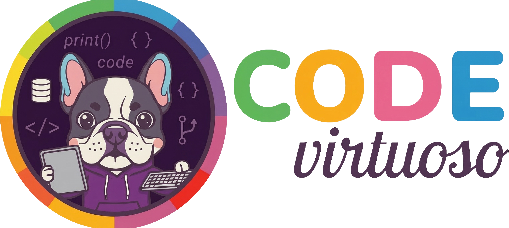

<p align="center">
  
</p>

# Code Virtuoso

[](https://github.com/krzysztofsurdy/code-virtuoso/releases)
[](LICENSE)

Agent-agnostic skills and sub-agents for software engineering, built on the open [Agent Skills](https://agentskills.io) standard. It installs as a Claude Code plugin marketplace and works in Codex and any other tool that reads `SKILL.md` files. Release notes are in [CHANGELOG.md](CHANGELOG.md).

## Install

Claude Code:

```
/plugin marketplace add krzysztofsurdy/code-virtuoso
/plugin install knowledge-virtuoso@code-virtuoso
/plugin install agents-virtuoso@code-virtuoso
```

The agents in `agents-virtuoso` preload skills from `knowledge-virtuoso`, so install both. Other bundles are listed below.

Any agent, with the skills CLI:

```bash
npx skills add krzysztofsurdy/code-virtuoso
```

Codex: skills come from the marketplace, agents from a script. Details are in [codex/README.md](codex/README.md).

```bash
codex plugin marketplace add krzysztofsurdy/code-virtuoso
scripts/install-codex-agents.sh
```

## What is inside

56 skills, 19 agents, and 3 team workflows, in seven bundles. Install any of them with `/plugin install <bundle>@code-virtuoso`.

| Bundle | Holds |
|---|---|
| `knowledge-virtuoso` | 17 knowledge skills |
| `tools-virtuoso` | 11 tool skills |
| `playbooks-virtuoso` | 8 step-by-step procedures |
| `frameworks-virtuoso` | 7 framework skills |
| `ai-virtuoso` | 4 skills for building with LLMs and agents |
| `agents-virtuoso` | 19 agents, 3 team workflows, 9 skills (see Agents and Teams) |
| `loop-virtuoso` | Delivery loop plugin, Claude Code only |

A skill marked "run by name" never loads on its own. It costs no context until you call it, for example `/solid`.

### Knowledge

| Skill | Purpose |
|---|---|
| `security` | OWASP Top 10:2025, auth, secrets, secure coding |
| `agent-security` | Prompt injection, sandboxing, and secrets for coding agents and LLM features |
| `debugging` | Root-cause method and post-mortem templates |
| `accessibility` | WCAG 2.1 and 2.2, ARIA, keyboard use, a11y testing |
| `context-engineering` | What a coding agent should see: AGENTS.md, rules, skill descriptions |
| `docs-lookup` | Fetch version-correct official docs instead of answering from memory |

Run by name: `design-patterns`, `solid`, `clean-architecture`, `refactoring`, `testing`, `api-design`, `database-design`, `performance`, `microservices`, `cicd`, `scrum`.

### Tools

| Skill | Purpose |
|---|---|
| `agentic-rules-writer` | Generate rules files for Claude Code, Cursor, Copilot, Codex, and more |
| `ticket-writer` | Write a story, bug, epic, or other ticket of the right type |
| `agent-creator` | Design a sub-agent |
| `plugin-creator` | Scaffold a Claude Code plugin |
| `brainstorming` | Turn a vague idea into an approved spec |
| `using-ecosystem` | Find the skill, agent, or team that fits a task |
| `pr-message-writer` | Write a pull request message with testing steps |
| `report-writer` | Make a standalone HTML report |
| `stakeholder-update-writer` | Draft a status update for Slack or email |
| `web-screenshot` | Capture a web page with shot-scraper |
| `image-annotate` | Add arrows, boxes, text, blur, and redaction to images |

### Playbooks

| Skill | Purpose |
|---|---|
| `ticket-delivery` | Ticket to pull request: investigate, plan, TDD, commit |
| `spec-driven-development` | Spec, plan, and tasks in the repo, then one task at a time |
| `tdd` | Strict red-green-refactor for agents |
| `finishing-branch` | Pre-push checks, merge strategy, PR message, cleanup |
| `pr-feedback` | Triage review comments and failing CI, fix, reply |
| `handoff` | Write and resume from a handoff note |
| `hooks-and-guardrails` | Deny rules, sandbox choices, and hooks for an agent setup |
| `worktree-ops` | Create, switch, and remove git worktrees safely |

### Frameworks

| Skill | Purpose |
|---|---|
| `symfony-components` | Version matrix, defaults, and pitfalls for Symfony |
| `symfony-upgrade` | Deprecation-first Symfony upgrades |
| `django-components` | Version matrix and common Django pitfalls |
| `langchain-components` | Choose between create_agent, LangGraph, and Deep Agents |
| `vercel-ai-sdk` | Version matrix, packages, the agent loop, TypeScript pitfalls |
| `php-upgrade` | PHP 7.4 to 8.5 with Rector and breaking changes |
| `composer-dependencies` | Safe Composer updates and security audits |

### AI engineering

| Skill | Purpose |
|---|---|
| `agent-design` | Workflow or agent, harness anatomy, tool permissions |
| `llm-evals` | Error analysis, binary graders, judge validation |
| `llm-observability` | OpenTelemetry GenAI traces, token and cost attribution |
| `mcp-server-development` | Tool design, response formats, shipping MCP servers |

### Agents

Twelve specialists and seven roles, all in `agents-virtuoso`. Role agents read templates and checklists from [roles/](roles/README.md). Full specs and headless use are in [AGENTS.md](AGENTS.md).

| Agent | Purpose |
|---|---|
| `investigator` | Explore a code area and map dependencies |
| `implementer` | TDD in a worktree |
| `reviewer` | Structured code review |
| `cold-reviewer` | Zero-context second review |
| `acceptance-verifier` | Check a diff against acceptance criteria |
| `refactor-scout` | Code smells and complexity hotspots |
| `test-gap-analyzer` | Missing tests and edge cases |
| `dependency-auditor` | CVEs, outdated packages, licenses |
| `migration-planner` | Risk-rated migration plan with rollback |
| `doc-writer` | Changelogs, API docs, migration guides |
| `plan-auditor` | Readiness gate and change-impact check |
| `instruction-auditor` | Audit AGENTS.md, CLAUDE.md, rules, skill descriptions |
| `product-manager` | Requirements, PRDs, prioritization |
| `architect` | System design and ADRs |
| `backend-dev` | API and data model work, TDD, worktree |
| `frontend-dev` | UI components and accessibility, worktree |
| `qa-engineer` | Test plans, bug reports, release sign-off |
| `project-manager` | Stage plans, risks, progress |
| `scrum-master` | Sprint planning and retrospectives |

### Teams

A team is a fixed recipe of agents, phases, and gates. In Claude Code, run it as a workflow. Other tools can follow the Markdown recipe in [teams.md](skills/knowledge/agent-orchestration/references/teams.md).

| Command | Does |
|---|---|
| `/agents-virtuoso:development-team` | Ticket to merge-ready branch, with a gate between phases |
| `/agents-virtuoso:review-squad` | Parallel reviews merged into one triaged report |
| `/agents-virtuoso:war-room` | Debate a technical decision and return a synthesis. You decide |

`agents-virtuoso` also holds `agent-orchestration`, `verification-before-completion`, and seven headless wrappers (`review-pr`, `review-pr-cold`, `verify-acceptance`, `find-test-gaps`, `plan-migration`, `audit-dependencies`, `scan-refactors`).

### Delivery loop

`loop-virtuoso` works in Claude Code only, because it ships hooks and scripts. It feeds the agent one small backlog item at a time and accepts the item only when its verify command passes and a write-boundary guard approves. Install it with `/plugin install loop-virtuoso@code-virtuoso`. See [plugins/loop-virtuoso/README.md](plugins/loop-virtuoso/README.md).

## More

- Run the read-only agents in GitHub Actions: [examples/ci/](examples/ci/README.md).
- Check that skills trigger and behave: [evals/README.md](evals/README.md).
- Saved choices such as ticket pattern and test command live in `.code-virtuoso` config files: [spec/config-spec.md](spec/config-spec.md).
- Add or change a skill or agent: [CONTRIBUTING.md](CONTRIBUTING.md).

## License

MIT. See [LICENSE](LICENSE).
